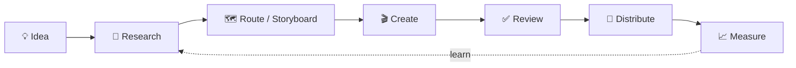
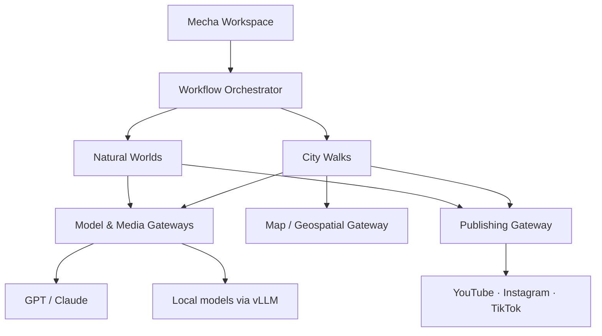

> **Current launch scope (2026-10-17): one Spanish-from-Spain YouTube channel first.** The earlier two-brand / six-account rollout below is a future portfolio direction, superseded for the first release by the [YouTube-first discovery proposal](docs/YOUTUBE_FIRST_DISCOVERY.md) and revised [roadmap](docs/ROADMAP.md). Channel, budget and providers await creator feedback; no implementation has started.

# Mecha

### One idea lights everything.

**An AI-assisted engine for researching, creating, distributing and learning from original digital content.**

[Vision](docs/VISION.md) · [Architecture](docs/ARCHITECTURE.md) · [Roadmap](docs/ROADMAP.md) · [Planning issue](../../issues/1)

`Spanish (Spain) first` · `English docs & code` · `Human-guided` · `Multi-brand` · `Multi-platform`

---

## What is Mecha?

**Mecha** means *wick* or *fuse* in Spanish: the small thing that starts something much larger. It starts with a human idea and helps transform it into researched, reviewable, publishable content.

## The first two content products

| Brand | Viewer experience | Core inputs | Initial channels |
|---|---|---|---|
| **Natural Worlds** | Photorealistic simulated drone journeys over real landscapes and natural environments, including realistic wildlife where appropriate | Verified geography/ecology + AI image/video generation | YouTube, Instagram, TikTok |
| **City Walks** | Immersive walks through real cities under varied conditions, enriched with sourced local context | Routes, places and permitted/licensed visual inputs + AI enhancement | YouTube, Instagram, TikTok |

Each product has its own three social accounts, editorial identity, credentials and analytics. Both reuse the same Mecha research, model, media, review and publishing platform.

Synthetic scenes are not presented as authentic documentary capture. Map imagery and place data are used only where provider terms, attribution and transformation rights permit it.

## The Mecha loop

## Architecture at a glance

The model gateway supports hosted proprietary providers such as GPT and Claude and an OpenAI-compatible local endpoint served with vLLM. Provider SDKs remain outside the domain, so a workflow can select models by capability, privacy, quality, latency and cost.

The City Walks pipeline uses a mapping abstraction for routes, places, coordinates and eligible imagery. A feasibility and policy gate must confirm current Google Maps Platform rights before any imagery is stored, transformed or rendered; alternative providers and licensed footage remain supported.

## Roadmap at a glance

| Phase | Outcome |
|---|---|
| **0 · Foundation** | Agree brands, boundaries, architecture and roadmap |
| **1 · Workspace** | Manage ideas and two separate brand workspaces |
| **2 · Research & Locations** | Build dossiers, routes, storyboards and the map-policy ADR |
| **3 · Model Gateway** | Connect GPT/Claude and local models through vLLM |
| **4 · Media Creation** | Produce one reviewed master for each content product |
| **5 · Publishing** | Render derivatives and publish through channel adapters |
| **6 · Analytics** | Measure each brand and run experiments |
| **7 · Monetization** | Connect performance to revenue opportunities |
| **8 · Agentic Automation** | Automate validated steps with observable agents |
| **9 · Scale** | Add locales, brands, models, channels and hardening |

See the detailed [implementation roadmap](docs/ROADMAP.md).

## Design principles

- **Value before volume.**
- **Research before generation.**
- **Separate brands, shared platform.**
- **Canonical content, many derivatives.**
- **Human agency at consequential boundaries.**
- **Provider independence.**
- **Rights, provenance and disclosure by design.**
- **Observability by default.**
- **Learn from outcomes.**
- **Localization is architecture.**

## Repository status

> 🚧 **Planning / Foundation**

No production implementation is intentionally included in the first PR. We first agree on what Mecha should become and the order in which to validate it.

Track the foundation in [Issue #1](../../issues/1).

---

<b>🔥 Mecha — one idea lights everything.</b>

