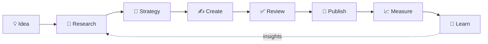
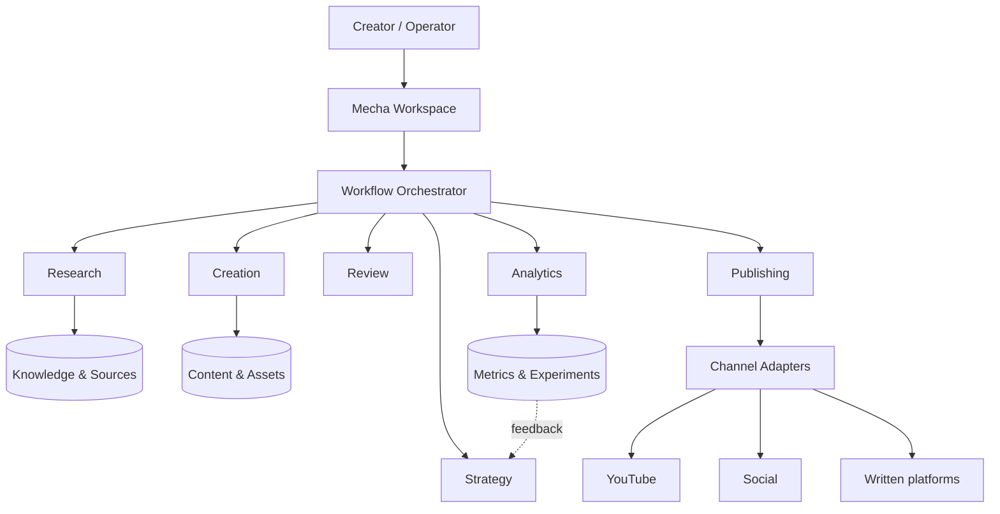

# 🔥 Mecha

### One idea lights everything.

**An AI-assisted content engine for turning original ideas into researched, created, distributed and measurable digital content.**

[Vision](docs/VISION.md) · [Architecture](docs/ARCHITECTURE.md) · [Roadmap](docs/ROADMAP.md) · [Planning issue](../../issues/1)

`Spanish (Spain) first` · `English docs & code` · `Human-guided` · `Multi-platform`

---

## What is Mecha?

**Mecha** means *wick* or *fuse* in Spanish: the small thing that starts something much larger.

Mecha starts with a human idea and progressively helps transform it into valuable content.

## Why build it?

AI makes content cheap to generate. That does **not** make content valuable.

Mecha uses AI to increase the leverage of **original thinking, evidence, taste and iteration**. It should help answer:

> What is worth creating, how should we create it, where should it go, and what did we learn?

## Initial market

| Concern | Decision |
|---|---|
| Product/code documentation | English |
| Initial generated-content locale | Spanish — Spain (`es-ES`) |
| Future languages | Supported through localization boundaries |
| Initial operator | Human creator |
| Automation philosophy | Progressive, observable and reversible |

Spanish-first does not mean Spanish-only. Locale, audience and channel are explicit domain concepts from day one.

## The Mecha loop

<b>1 · Ignite — capture an idea</b>
 
Turn a rough thought, question, observation or opportunity into a structured content seed without forcing the creator through a large form.

<b>2 · Explore — research before generating</b>
 
Gather trustworthy sources, competing perspectives, trends and supporting material. Preserve provenance so claims can be traced to evidence.

<b>3 · Shape — choose the right content</b>
 
Recommend audience, angle, format and channels. A topic may become a long-form video, short, article, thread, book section—or nothing at all.

<b>4 · Create — produce reusable assets</b>
 
Generate a content brief and channel-specific derivatives while maintaining a canonical source of truth. Human review remains part of the workflow.

<b>5 · Release — publish safely</b>
 
Use modular channel adapters, approval gates, schedules and idempotent publication records instead of coupling the core domain to platform APIs.

<b>6 · Learn — close the loop</b>
 
Normalize analytics and revenue signals across platforms. Feed evidence back into future research and strategy rather than blindly optimizing for views.

## Product map

## Roadmap at a glance

| Phase | Outcome |
|---|---|
| **0 · Foundation** | Agree product boundaries, architecture and roadmap |
| **1 · Workspace** | Capture and manage an idea end-to-end |
| **2 · Research & Strategy** | Turn ideas into evidence-backed content plans |
| **3 · Creation** | Produce reviewable canonical content + derivatives |
| **4 · Publishing** | Release through modular channel integrations |
| **5 · Analytics** | Measure outcomes and run experiments |
| **6 · Monetization** | Connect content performance to revenue opportunities |
| **7 · Agentic Automation** | Automate safe parts of the loop with observable agents |
| **8 · Scale** | Add locales, channels, brands and production hardening |

See the detailed [implementation roadmap](docs/ROADMAP.md).

## Design principles

- **Value before volume.**
- **Research before generation.**
- **Canonical content, many derivatives.**
- **Human agency at consequential boundaries.**
- **Provider independence.**
- **Observability by default.**
- **Learn from outcomes.**
- **Localization is architecture.**

## Repository status

> 🚧 **Planning / Foundation**

No production implementation is intentionally included in the first PR. We first agree on what Mecha should become and the order in which to validate it.

Track the foundation in [Issue #1](../../issues/1).

---

<b>🔥 Mecha — one idea lights everything.</b>

