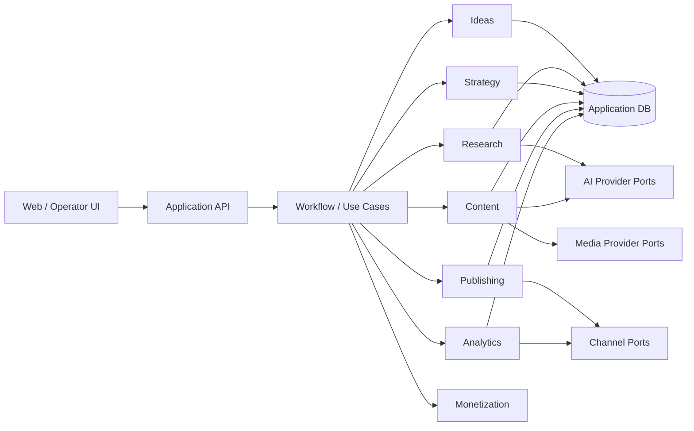

# Architecture

## Architectural intent
Start as a **modular monolith with explicit domain boundaries**, not as a distributed multi-agent system. Agents are an orchestration technique—not the domain model.



## Core domain concepts
- **Idea:** smallest intentional input; records origin, intent, locale and lifecycle.
- **Research dossier:** sources, claims, counterpoints, freshness and provenance.
- **Content brief:** audience, problem, angle, format, voice, objectives and evidence.
- **Canonical content:** authoritative creative work before platform transformation.
- **Derivative:** channel/format-specific representation linked to canonical content.
- **Asset:** text/image/audio/video/etc. with provenance and generation metadata.
- **Publication:** durable record of what was sent where, when and from which version.
- **Metric observation:** normalized timestamped measurement.
- **Experiment:** hypothesis + controlled variation + success metric.

## Suggested repository shape
```text
mecha/
├── apps/
│   ├── api/
│   └── web/
├── src/mecha/
│   ├── ideas/
│   ├── research/
│   ├── strategy/
│   ├── content/
│   ├── publishing/
│   ├── analytics/
│   ├── monetization/
│   ├── orchestration/
│   └── shared/
├── integrations/
│   ├── ai/
│   ├── media/
│   └── channels/
├── tests/
├── docs/
└── README.md
```
This is a target structure, not a reason to create empty folders prematurely.

## Workflow
Long-running work must be resumable and observable:
`DRAFT IDEA → RESEARCHING → STRATEGY READY → CREATING → REVIEW REQUIRED → APPROVED → SCHEDULED/PUBLISHED → MEASURING → LEARNING`.

## Provider boundaries
LLMs, research/search, media generation, storage, publication channels, analytics and monetization systems are adapters behind ports. Domain objects must not depend on provider SDK objects.

## Agent model
Do **not** start with many autonomous agents. Introduce one when a task benefits from iterative tool use, dynamic planning, context-dependent branching or autonomous recovery. Prefer deterministic code for validation, state transitions, permissions, publication, accounting and data integrity.

## Provenance
Artifacts should retain originating content/idea, sources, model/provider/version, prompt/config, human edits/approval, cost and published version.

## Safety and control
Credentials stay outside prompts/content; integrations use least privilege; publishing initially requires approval; external actions should be idempotent; factual claims retain evidence.

## Open implementation decisions
Python/web stack, persistence, UI stack, workflow engine, AI/search/media providers, first publication channel, deployment, authentication, observability and cost accounting should be selected when a roadmap phase creates a concrete requirement.
