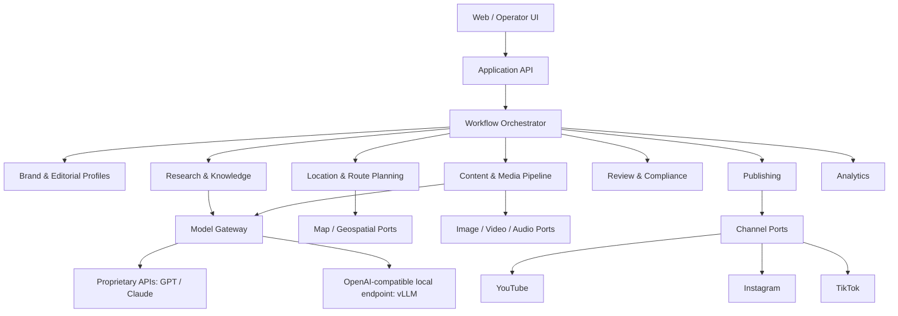

# Architecture

> **Approved baseline (2026-10-17):** Python + Manim + FFmpeg, optional Blender, ChatGPT/OpenAI plus Claude/Anthropic assistance, and the creator’s own recorded voice. Initial AI use is operator-assisted; API usage and cloud compute are separately costed, with no new paid services authorized. See [approved choices](PHYSICS_CHANNEL_PLAN.md#approved-technology-baseline--2026-10-17).

> **Current scope:** physics/engineering is the first and only initial YouTube channel. The later portfolio is AI Explained, Relaxing Aerial Journeys and Current Affairs Explained. See [physics-first contracts and production plan](PHYSICS_CHANNEL_PLAN.md). Earlier landscape/city pipelines below describe future extensions, not launch requirements.

## Architectural intent
Start as a **modular monolith with explicit domain boundaries**, not as a distributed multi-agent system. Agents are an orchestration technique—not the domain model. The first product is one physics/engineering brand on a shared platform designed to support later brands.



## First production pipeline

`creator topic → sourced brief/claims → reviewed script → timed diagram/shot plan → voice and visual proof → deterministic render → review → private upload → approved YouTube publication`

Use Python, Manim Community and FFmpeg as the recommended proof stack; add Blender only for needed 3D scenes. One selected text adapter and narration provider are sufficient. This is a recommendation pending cost and sample review, not an instruction to provision paid services. Store EpisodeBrief, ClaimEvidence, ScriptRevision, SceneSpec, RenderManifest, CostLedger and ReviewDecision; parameters include units, scale caveats and source links. Revision hashes prevent stale approvals. A CLI-driven proof precedes a broad web workspace.

## Future location-based content pipelines

### Natural Worlds
`real location → sourced location dossier → scene/storyboard → realistic landscape/wildlife generation → continuity/upscale/edit → disclosure and review → platform derivatives → publish`

Inputs include verified geography, season, ecology and shot intent. Generated animals and environments retain prompt, model, seed/configuration and source provenance. Review checks realism, ecological plausibility, rights and whether the result could mislead viewers into believing synthetic footage is documentary capture.

### City Walks
`city + conditions → route proposal → permitted map/POI/imagery acquisition → timeline → enhancement/editing → contextual narration/overlays → attribution and review → platform derivatives → publish`

The map integration is an abstraction, not a dependency on recorded Google Maps UI. A Google adapter can use allowed Maps Platform capabilities for route geometry, place data and eligible imagery. A policy gate verifies current terms, attribution, storage and derivative-use requirements before rendering or publishing. Alternative geospatial and licensed-footage providers remain possible.

## Model gateway
The domain calls capability-oriented ports such as `generate_text`, `structure_research`, `create_storyboard` and `describe_scene`; it never imports a provider SDK.

Two adapter families are planned:

1. **Hosted proprietary models** — adapters for OpenAI GPT and Anthropic Claude, with per-task routing, credential isolation, rate limits and cost tracking.
2. **Local open models** — an OpenAI-compatible adapter targeting a user-managed vLLM server. Model discovery, health checks, GPU constraints, timeouts and fallback behavior are configuration.

Prompt templates, structured-output schemas and evaluations are shared where capabilities permit. Routing records provider, model, version, latency, token usage, cost and fallback reason. vLLM is a serving connector, not a model itself.

## Map and geospatial gateway
Ports cover geocoding, route planning, street-level references, places/POIs, elevation and attribution metadata. Provider responses are normalized into a `LocationDossier`, `RoutePlan`, ordered `RouteSegment` records and source references.

Raw provider imagery is not assumed to be reusable or editable. Each asset carries provider, license/terms snapshot, attribution, retention rules and permitted transformations. A render job cannot proceed when rights are unknown.

## Media pipeline
A reproducible job graph handles storyboards, image/video generation, optional licensed source footage, temporal consistency, interpolation, upscaling, audio, narration, subtitles, captions, thumbnails and final encoding. Large assets live in object storage; the application database stores metadata and lineage. CPU/GPU work runs asynchronously through workers with resumable job state.

## Publishing architecture
A `ChannelAccount` belongs to a brand and platform. Initially configure ONE Physics & Engineering YouTube account. Later brands and Instagram/TikTok adapters remain deferred.

Channel adapters own OAuth, upload/resumable upload, platform metadata, scheduling capability, idempotency and external IDs. The core produces a platform-neutral release package; adapters validate duration, aspect ratio, codec, caption and thumbnail constraints. Unsupported scheduling falls back to an approved publish queue rather than browser automation.

## Core domain concepts
- **Brand:** editorial identity, disclosure policy, locale and channel accounts.
- **Idea:** intentional input with origin, brand, locale and lifecycle.
- **Location dossier:** verified geography, POIs, ecology/history, sources and permitted media references.
- **Route plan:** ordered coordinates/segments, conditions and narrative stops.
- **Research dossier:** sources, claims, counterpoints, freshness and provenance.
- **Content brief:** audience, angle, format, voice, objectives and evidence.
- **Storyboard/timeline:** ordered scenes, shots, narration and overlay cues.
- **Canonical content:** authoritative creative work before platform transformation.
- **Derivative:** channel/format-specific representation linked to canonical content.
- **Asset:** text/image/audio/video with lineage, rights and generation metadata.
- **Publication:** durable record of what was sent where, when and from which version.
- **Metric observation:** normalized timestamped measurement.
- **Experiment:** hypothesis, controlled variation and success metric.

## Suggested repository shape
```text
mecha/
├── apps/
│   ├── api/
│   ├── web/
│   └── workers/
├── src/mecha/
│   ├── brands/
│   ├── ideas/
│   ├── research/
│   ├── locations/
│   ├── content/
│   ├── review/
│   ├── publishing/
│   ├── analytics/
│   ├── orchestration/
│   └── shared/
├── integrations/
│   ├── models/
│   │   ├── openai/
│   │   ├── anthropic/
│   │   └── vllm/
│   ├── maps/
│   ├── media/
│   └── channels/
│       ├── youtube/
│       ├── instagram/
│       └── tiktok/
├── tests/
├── docs/
└── README.md
```

## Workflow
Long-running work must be resumable and observable:

`DRAFT → RESEARCHING → ROUTE/STORYBOARD READY → GENERATING → REVIEW REQUIRED → APPROVED → RENDERING → READY → SCHEDULED/PUBLISHED → MEASURING → LEARNING`.

## Storage and runtime components
- Relational database for workflow state, metadata, publications and metrics.
- Object storage for source and rendered media.
- Queue and CPU/GPU workers for long-running generation and encoding.
- Secrets manager for model, map and social credentials.
- Scheduler for publishing and analytics ingestion.
- Observability for traces, logs, media-job progress, model usage and cost.
- FFmpeg-based deterministic assembly/encoding behind a media-processing port.

## Agent model
Do **not** start with many autonomous agents. Introduce one when a task benefits from iterative tool use, dynamic planning, context-dependent branching or autonomous recovery. Prefer deterministic code for validation, state transitions, permissions, publication, licensing gates, accounting and data integrity.

## Provenance, safety and control
Artifacts retain originating idea/brand/location, sources, model/provider/version, prompt/config, human edits, approval, cost, rights/attribution metadata and published version. Credentials stay outside prompts/content; integrations use least privilege; publishing initially requires approval; external actions are idempotent. Real places, people, wildlife and cultural claims require sourced review, and synthetic or materially altered footage follows a clear disclosure policy.

## Open implementation decisions
Python/web stack, persistence, object storage, queue/workflow engine, first media models, first mapping provider and allowed usage, social API eligibility, deployment, authentication, observability and cost accounting are selected only when a roadmap phase creates a concrete requirement.
