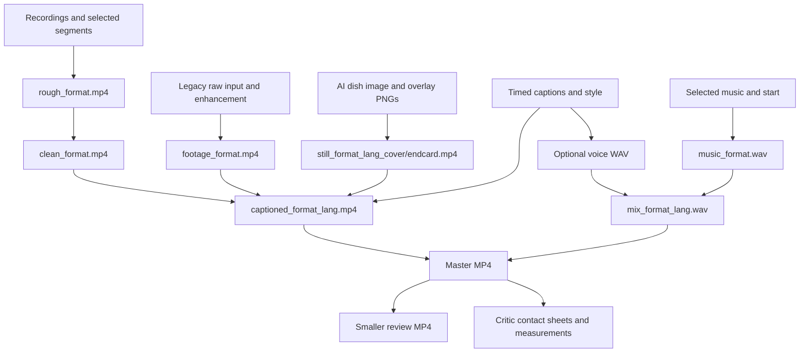

# Plate & Price production flow

Inspected 2026-10-27. Paths below are relative to `plate-and-price/` inside the Git clone unless marked otherwise. This records the existing execution path and the baseline differences found before the Codex udon-short review. Changes made by that review are recorded in its own history.

## Repository scope

The Git root `_repo/` now contains only the Plate & Price project: the nested `plate-and-price/` folder holds its `README.md`, `CLAUDE.md`, scripts, recipe inputs, brand assets, configuration and n8n workflows. Its content defaults to English, with separate Spanish outputs.

`scripts/common.py` anchors `ROOT` to this nested project, reads its `.env` without replacing existing process variables, and resolves `PLATE_OUTPUT_DIR`. The inspected rendered assets live outside Git at:

`C:\Users\panur\OneDrive\Documentos\GITProjects\Mecha\plate-and-price\output`

No API credentials are needed to rebuild an existing short when its recordings, cover image and music already exist. Raw footage, voice audio and rendered videos are git-ignored. Keys stay in the local environment or `.env`.

## Inputs and their consumers

| Input | Consumer and purpose |
|---|---|
| `input/<id>/video.json` | Timeline, source in/out points, hook, format dimensions, framing, captions, cleaning, audio, voice, chapters and description copy |
| Recordings, either `raw.mp4` or named clips | `cut_rough.py` or the legacy `edit_short.py` footage builder |
| `segments[].caption.en/es` | `make_captions.py` generates timed SRT; without these it keeps existing SRT unchanged |
| `captions_<format>_<lang>.srt` | Burned captions and, for a narrated video, voice script fallback |
| `price.json` | Cover price, itemized end card, description, critic evidence; amounts are estimates unless supported by receipts |
| `recipe.md` | Context for reviewers; it does not generate the cut |
| `cover_ai_9x16.png`, `cover_ai_16x9.png` | Existing AI dish photographs under title/brand/price overlays |
| Optional `cover_<format>.png`, `endcard_<format>.png` | Manual overrides preferred over generated language-specific cards |
| Optional `voice_<format>_<lang>.wav` | Recorded narration preferred over generated TTS |
| `audio.source` | Either the raw recording's audio or a music file under the recipe folder |
| `config/channel.json`, `brand/` | Channel name, localized tagline, colors, labels, icon and other brand assets |

Short: 1080×1920, captions and music, no narration. Long video: 1920×1080, usually blurred background padding, captions plus calm narration. They have separate segment lists and caches.

## Main command and stage sequence

From this project folder:

```powershell
uv run --with pillow --with imageio-ffmpeg --with edge-tts python scripts/run_pipeline.py <id> --format short --lang en
```

Use `--format video` for the long version and `--lang es` for Spanish. The command does not upload anything or send email. It invokes the following scripts in order:

1. **Rough cut and cleaning, for the staged recording path.** The baseline condition is `if not meta.get("raw")`. `cut_rough.py` seeks the selected recordings, validates that cuts do not exceed their duration, scales/crops or pads each shot, optionally blends source frames using `shutter`, and joins them with their original sound. `clean_footage.py` denoises, adjusts range/highlights/shadows/color and sharpens lightly. Each stage writes its own cached layer plus a convenient recipe-root preview.
2. **Captions.** `make_captions.py` derives SRT from segment captions. Timeline order is moving hook, cover, chronological cooking clips, end card. Short captions end 0.2 s before each cut. Narrated-video captions start 0.3 s after the cut and end 0.5 s before it. A separate `.voice.srt` can add narration over the cover and end card. If the selected language's SRT is still missing, `translate_captions.py` makes a paid LLM request; otherwise no translation is requested.
3. **Cover image check.** `make_cover_ai.py` preserves existing externally supplied images without `.key` files. Missing images are reported or planned according to `config/cover_ai.json`. The pipeline never supplies `--confirm-paid` and ignores this step's nonzero exit status. Missing art therefore is not reliably a hard stop.
4. **Cover and end card.** `make_cover.py` draws localized title, branding and per-serving price onto the AI image. The landscape version also writes the thumbnail. `make_endcard.py` draws the estimated bill. These scripts run unless a format-level manual override exists. The PNG generation itself is not cached; the downstream still-video layers are.
5. **Narration for the long video only.** Unless recorded voice exists, `make_voice.py` uses free online `edge-tts` per sentence, places each line in its caption window, limits acceleration using `tempo_max`, and caches the combined WAV. It warns about overflow; it does not automatically shorten a sentence. Existing recorded voice wins.
6. **Layer assembly.** `edit_short.py` builds or reuses the picture/audio layers below, muxes the master, and encodes the smaller email review copy.
7. **YouTube text.** `make_description.build()` writes title, description, tags and private notes. Shorts append `#Shorts`. Videos include the itemized estimate and validated chapters. A music credit is included only for music marked licensed, and only in the long-description path. No LLM is used unless the standalone description command explicitly receives `--llm`.
8. **Result.** The pipeline prints a reminder to consult the critics, followed by a final JSON line containing `master`, `review`, `youtube_title`, `description_file` and description body. This JSON is consumed by n8n.

The owner's staged review process is an operating instruction in `CLAUDE.md`. The baseline command does not persist stage approvals or pause for them.

## Cached layer graph



`scripts/layers.py` writes one `.key` beside each cached file. Keys combine input fingerprints, settings and relevant builder source. Most file signatures hash content; rough-cut source fingerprints use filename, size and integer modification time for large recordings. Builders write a temporary file and replace the layer after success.

| Change | Layers that must change |
|---|---|
| Captions/style | Captioned picture, final, email copy; also TTS/mix when narration uses those captions |
| Clip selection/framing | Rough, clean, captioned picture, final, email; music also when total duration changes |
| Clean settings | Clean, captioned picture, final, email |
| Cover/end-card image or duration | Respective still, captioned picture, final, email; audio when total duration changes |
| Music/source start | Music, mix, final, email |
| Narration file/voice | Voice, mix, final, email |
| Description copy/tags only | Description file, with no video rebuild |

`--force` on the main command targets render layers; in the baseline implementation it does not forward force to rough or clean. Those individual commands have their own `--force`. The mix fingerprint includes `build_mix` source but not the module-level `LOUD` constant separately, so changing that constant alone needs a forced mix rebuild.

## Review loop and destination folders

`review_pack.py <id> --format short --lang en` reads the rendered master and creates one-frame-per-second contact sheets, caption timeline, pacing statistics, measured LUFS/loudness range/true peak, price/recipe facts, copied cover or thumbnail and YouTube text. It also creates four source frames per recording. Source sheets are reused whenever any existing source sheet is found, so source additions/replacements require deliberate regeneration.

All seven roles are defined in `.claude/agents/`; Codex equivalents and operation instructions are documented separately in `review/codex.md`. Reviewers do not edit files. The producer applies or declines each tagged fix, rebuilds affected layers, regenerates evidence, and repeats for three rounds. Decisions belong in `review/history/<id>.md`. Four language-dependent roles review English and Spanish separately; engagement and craft share a cut review; audio shares the music-only short review but splits narrated versions.

`review_video.py` is an optional API-backed alternative, not a step called by `run_pipeline.py` or either supplied n8n workflow. Its baseline implementation reads Claude role files and calls `llm_client.py`. The language-selection helper functions are present but unused by `main()`, so every role is called for every invocation. The OpenAI adapter sends text only, and the review runner passes the Claude role's model name even if the selected provider is OpenAI. Do not treat that path as a validated Codex-agent runner.

```text
<output>/<id>/layers/     cached picture/audio intermediates and their .key files
<output>/<id>/review/     reviewer facts, sheets and extracted frame folders
<output>/<id>/email/      small review MP4s, not automatically sent by Python
<output>/<id>/final/      current masters, descriptions and long-video thumbnails
<output>/<id>/archive/    replaced master MP4s and their fingerprints
```

Baseline `edit_short.py` archives a previous master before replacing it. Descriptions and thumbnails are overwritten without archival. The build places files in `final/` before critics run; the reminder is not an enforced approval gate. Consequently, folder location alone is not proof of critic review or owner approval. No publishing/upload implementation is present.

## Gnocchi reference versus udon baseline

| Aspect | `gnocci-blue-cheese-and-veggies` | `udon-teriyaki-secreto-iberico-gambones` before this review |
|---|---|---|
| Recording metadata | `raw: null`, individually named `GH...MP4` sources | `raw: "raw.mp4"` |
| Picture generation | Rough then clean; both layers exist for both formats | Legacy `footage_short/video.mp4` layers; no staged rough/clean layers |
| Hook | First segment is flagged moving hook | No hook flag; still cover first |
| Caption authority | English/Spanish text in each segment | Separate hand-timed SRT; no segment captions |
| Clean settings | Warmth/cast/highlights settings plus shutter controls | Legacy `enhance` filters only |
| Short | 42 s from reviewed timeline | 41 s: 2 s cover + twelve 3 s clips + 3 s bill |
| Existing products | English/Spanish short and long master, descriptions, thumbnails, review copies | Same four product combinations already present |
| Review history | Four original critics, three rounds, then unreviewed tweaks; three later critics and separate Spanish review explicitly pending | No equivalent recipe history at inspection |

At inspection the gnocchi output had 44 layer files, 14 final-folder files and 12 archived files; udon had 40 layer files, 14 final-folder files and an empty archive. These counts include fingerprints and are only a baseline snapshot. Gnocchi's rendered artifacts demonstrate the staged implementation; its history does not establish completion of the newer seven-agent requirement.

Udon's legacy `build_footage` fill path scales directly to the target aspect ratio before zoom, whereas `cut_rough.py` preserves aspect ratio and crops. Moving udon onto the staged path addresses both the mandatory cleaning gap and that framing difference. Any such move should preserve access to `raw.mp4` as the selected music source and leave the long version's settings alone for a short-only task.

## n8n and optional integrations

Both workflow JSON files are inactive manual workflows: trigger → params → execute pipeline → read review video → Gmail review message. Both default to the udon recipe and English. They require local `uv`, file access, an enabled Execute Command node and configured Gmail OAuth. Their text parses the pipeline's last stdout line as JSON.

The baseline file-read node still points at `<output>/<id>/<format>_<lang>_review.mp4`, while current Python writes `<output>/<id>/email/<format>_<lang>_review.mp4`. It also derives the output directory from `projectDir` rather than the returned `review` value. Update that selector before using n8n. Neither workflow runs critics or checks approval. These workflows were inspected, not executed; no email was sent.

`pick_music.py` separately queries Jamendo, filters downloadable instrumental tracks using allowed license URL patterns in `config/music.json`, downloads the choice and updates the recipe metadata plus a music catalog. It is not automatically called by the pipeline. Existing udon and gnocchi tracks are marked unlicensed commercial recordings; reviews must not represent them as cleared music.

`translate_captions.py`, optional description polishing and `review_video.py` use `llm_client.py` HTTPS provider calls. They do not implement an account-balance gate. `make_cover_ai.py` requires explicit paid confirmation but allows an unknown price/balance; operator credit checks remain required. Reusing the existing covers avoids image API requests.

`comfy_client.py` and `.mcp.json` provide optional local ComfyUI access, but no production enhancement workflow is stored or called by the main pipeline. `make_brand_assets.py` draws icon/banner/watermark locally; it is a setup tool, not a per-video stage.

This document is based on code/configuration, output inventories and existing review history. It does not assert that n8n, paid integrations, publishing, subjective playback quality or newly revised renders were tested.


## Changes made for the Codex udon-short run

The udon short now opts into the dedicated rough/clean path with `formats.short.clean_first`; `raw.mp4` still supplies its original music and the long video retains its prior configuration. Its TV-range source is explicitly respected. Captions now live in bilingual segments, with a moving hook, a chronological recipe, a wider plated reveal and a five-second price-first full bill.

`formats.short` carries its own description overrides and estimate note, phone-safe cover/card options and 78 px cream caption style. The renderer supports caption colour and horizontal safe margins. Directive 25 and the pipeline reminder keep caption readability in every future workflow. Caption/note wording is excluded from picture cache keys; the loudness target is included in the mix key. Existing cached layers are reused on a repeated run in both languages.

The seven Codex agent definitions and session review process are in `.codex/agents/` and `review/codex.md`. Three complete critic rounds, individual decisions, evidence limitations and final validation are in `review/history/udon-teriyaki-secreto-iberico-gambones.md`. The n8n/API gaps described above were documented, not executed or repaired as part of this short-only task.
